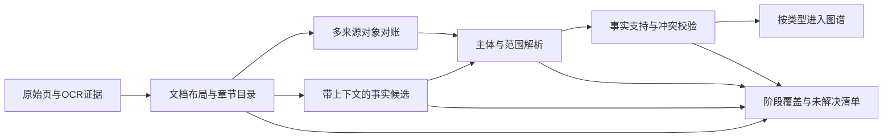

# 抽取核心架构评估与改造路径

2026-10-13。结论：运行入口、来源链接和任务状态有可局部修复的缺陷；对象丢失、章节串联、语义误报、范围丢失和表格错位形成了一个抽取核心问题集群，需要改变中间数据及处理顺序。现有界面、人工维护、存储、监测等模块可继续使用。

## 已实施的边界修复

- 上传携带页面设置，后端在保存文件前校验，并按同一参数约定启动任务。
- PDF来源链接带有效物理页码。
- OCR入口统一矩形/多边形和图片像素/PDF点坐标，保存变换与原始坐标；无法恢复变换时保留原始证据并明确标记。
- 深度失败、部分完成、无适用对象分开表达；不完整尝试保存为尝试记录，不替换已有深度成果。没有章节样本的对象显式记录跳过原因。

这些修复保证边界和状态表达正确，尚不解决全部事实质量问题。

## 为什么不是继续加几个正则就够了

当前顺序大致为：汇总表注册工点 → 只接受已注册对象的章节切分 → 字典/正则及大模型抽取 → 合并字段 → 图谱。下游阶段对上游结果依赖过强，缺少独立对账。

| 架构缺口 | 具体机制 | 普通补丁的局限 |
|---|---|---|
| 对象目录与章节目录混在一起 | 正文标题只有进入注册对象白名单才生效；汇总表已有输出时正文发现不再补充 | 增加桩号识别规则仍不能保证未知标题结束旧对象作用域 |
| 上下文是一个会延续的当前工点 | 新标题被忽略、正文转通用章节后，后续语句仍可能归属旧对象；表格找最近的有效标题 | 数值识别再准也会变成错对象事实 |
| 事实形成太早 | 首次非空值、关键词或单一坡面值可提前进入整体字段；局部/整体/设计/历史身份不统一 | 增加同义词会改善召回，同时可能扩大误报；无法稳定管理冲突 |
| 证据出现与证据支持混同 | 引句能在原文中找到，但它可能是要求、条件、预测或模拟 | 引句核验通过不等于原文断言了该事件 |
| 知识类型被压成同一观测节点 | 设计建议、报警条件、观测清单和历史事实没有贯穿流程的独立角色 | 逐个添加“建议/应/可能”等过滤词会漏掉真实历史描述，且丢失本应保留的规则知识 |
| 覆盖统计只看已产出的对象 | 对象缺失、没有章节、未进入模型、调用失败、资料未选页难以区分 | 大模型通过率或任务完成不能代表知识召回；没有未处理分母 |

程序模块已拆分，并不意味着上述语义边界已经建立。代码文件之间可以低耦合，数据处理仍可能依赖同一个错误的主体或作用域。

## 建议的抽取主干

大白话：先知道每一段在谈什么，再保留“它可能表达了什么”；确认对象、数值范围、知识类型和原文依据后才成为图谱事实。不能因为对象还没确认，就把整段丢掉或借给上一对象。

### 一、独立章节目录

章节目录先于工点归属建立，保留章节编号、标题、起止页/版面区域、父章节及类型。即使标题中的工点未登记或桩号矛盾，也形成章节边界。通用要求、计算方法、工程总结和附图不自动延续最后一个工点。

汇总表、正文标题、图题、表题分别发现对象候选。之后对账，输出明确匹配、可能别名、源冲突、未解决，保留出处。矛盾桩号不能自动拼成一个“确定正确”的身份；未知对象不能消失。

### 二、事实候选作为中间层

一个候选至少包含：

| 信息 | 用途 |
|---|---|
| 候选ID、来源文档版本、页/区域、章节、原句 | 复现和回查 |
| 主体候选、主体层级及关系 | 整坡、局部危岩、计算断面、设计构件或通用对象 |
| 属性、值类型、数值或双端范围、单位 | 不把范围压成单值，不把最大值变成上下限 |
| 工况、时间及知识角色 | 现状/治理后，历史/当前，事实/预测/条件/要求/模拟 |
| 抽取来源、支持检查、冲突、待核原因 | 区分规则产物、模型产物和未解决候选 |

现有PropertyAssertion可作为迁移接缝，但必须在“合并整坡属性”之前形成候选。只在最终值上补一条来源，无法找回早期丢掉的主体、范围和冲突。

### 三、统一解析和校验

规则与模型都输出同一种候选，不能各自直接写图谱。原文数字范围、单位、表头跨度和句子角色形成公共解析能力。表格基于位置、父子表头及工况行标签对齐；不确定项保留候选。

校验至少检查：主体是否有依据、知识角色是否一致、数值及单位是否支持、工况/断面/危岩身份是否完整、局部值是否被误用为整体、是否跨章节或存在源冲突。不同类型分别进入历史观测、设计措施、要求/规则、预测/模拟等结构。

### 四、覆盖与发布独立

按文档和阶段列出已发现对象、章节有来源的对象、事实候选、已确认/拒绝/待核候选、模型成功/失败/跳过及原因。仅登记、OCR完成、已抽取、已核验、已发布分别记状态。

完成状态是阶段运行结果；精确率/召回率是固定原文样本对照结果；正式风险可用性又是另一项验收，三者不能互相替代。发布记录应包含来源、解析/抽取方案、模型/提示词、图谱版本和质量状态。当前已阻止不完整深度尝试覆盖旧深度文件；完整的版本化发布及原子切换仍需要后续统一设计。

## 迁移方式与验收

1. 保留旧流程可重复的基线。先建立独立章节目录和对象候选对账，在旁路生成差异，不立即改变图谱。
2. 将一个事实类型迁入候选层：先主体/作用域，再整体几何或稳定系数。逐项验证归属与身份，避免整模块一次重写。
3. 接入句子角色与知识类型，再迁移复杂表格、图形及设计参数。保留真实历史观测正例，防止一刀切过滤。
4. 确认所有已迁移类型和未解决项统计后，再移除对应旧路径。界面和存储通过适配器维持现有接口。

验收必须同时看FP与FN、冲突/待核比例和未处理覆盖；固定集及旧保护集不退回，再用未见完整报告检查泛化。使用匿名变换用例（换桩号、换数值、改章节顺序、目录缺行、跨页/合并表头、设计与实况混排）验证规则，而不是把真实样本答案写进代码。不能用架构更整齐、功能测试通过或开发集分数提升替代事实质量验收。

此前已完成入口、坐标与任务状态修复。2026-10-13后续研究及试验实现了第一段章节/主体改造，下面记录其范围和验证；事实候选主干及完整文档树仍待迁移。

## 资料调研与本轮采用的办法

参考资料查阅日期：2026-10-13。

| 原始资料 | 支持的设计思路 | 在项目中的采用范围 |
|---|---|---|
| [Docling官方文档模型](https://docling-project.github.io/docling/concepts/docling_document/)及[技术报告](https://arxiv.org/abs/2408.09869) | 内容项、阅读顺序、章节层级、版面与来源应有独立表示 | 先从现有解析结果建立独立编号标题目录；本轮未安装或集成Docling，未声称达到其版面识别能力 |
| [W3C PROV-DM](https://www.w3.org/TR/prov-dm/) | 保存结果由哪些来源、哪些处理活动产生，支持回查和重现 | 保留标题、支持图注、源冲突和决策原因；采用来源追溯原则，未实现PROV标准交换格式 |
| [ConText原论文](https://www.sciencedirect.com/science/article/pii/S1532046409000744) | 提及与否定、假设、时间、对象语境应分别判别；表层线索仍有局限 | 支持下一步分离事实角色及作用域的方向；其验证来自临床报告，不能直接当作中文工程报告的有效性证据，本轮未迁移此算法 |

由这些资料和已核原文推断，本项目先纠正对象/章节依赖顺序，再迁移事实语境，收益和风险更容易验证。单纯更换模型、增加提示词或全盘更换解析器，尚不能解决登记白名单导致的对象消失及错挂。

## 第一段改造已实现

`sections.py`先识别编号标题，不依赖一览表白名单。勘察报告中有效、单对象标题，只有在同一章节范围内另页正文或图注出现同一桩号，才能补入根对象。目录、页眉、同页OCR重复不算独立支持；错误一览表原行仍留待核，不自动改写别名。未解决的标题也截断旧对象，续页不能回落到上一处边坡。

作用域遵循报告实际标题层级。同一对象的小节继续归属，平级/上级的新章节终止延续。明确写作“危岩体”的子范围，只有完整落在唯一已有边坡范围内才作为其子对象，保留原子范围；单凭桩号包含关系不合并两处边坡。工程表先定位最近标题，再检查对象能否解决；未知标题后的表格保留为未归属候选。

处理审计增加标题主体状态和无正文样本对象。它是阶段覆盖诊断，不是精确率或召回率。另修复无编号“结构面”紧接角度时正则吞掉首位数字的问题，匿名多组角度测试约束这一词法边界。

## 本轮验证与限制

固定200项已人工核对的开发事实，保持答案、排除项、原始PDF及解析缓存不变。与上一轮完成坐标修复后的同条件基线比较：

| 模式 | 正确/误报/漏报：前→后 | 精确率：前→后 | 召回率：前→后 |
|---|---|---|---|
| basic＋已有OCR | 158/6/42 → 164/4/36 | 96.34% → 97.62% | 79.0% → 82.0% |
| deep缓存重校验 | 159/11/41 → 165/9/35 | 93.53% → 94.83% | 79.5% → 82.5% |

逐项检查两模式原有正确事实无损失；新增6项正确，纠正2项错挂。旧95项组不退回，新105项组改善。293项后端/匿名/本地语料检查通过，包括目录伪标题、跨章引用、未知主体、子对象和跨页续文反例。本轮还重新看了2份PDF的5张原页，确认新增对象、计算表归属和子危岩反例；这些是既有开发样本的复核，不计作新增盲测样本。

改造后63处登记对象中60处有保留的正文样本，3处只有登记而缺正文仍明确列出。这个比例不是原始资料的事实覆盖率。58张计分原页占6份勘察报告461页约12.6%，是经过挑选的开发集，不能把97.62%/82.0%当作全项目的总体质量。

本轮零外部模型调用、未重跑真实OCR、未激活生产图谱；deep结果仅复用旧候选并重校验，新发现对象没有新模型抽取。已确认的要求/建议/模拟被误当历史事实等语义问题仍待角色层改造。完整层级树、无编号标题、子对象重叠/冲突及图中数值读取也尚未解决。

下一段先让规则与模型共同产出带角色、对象、工况、范围的事实候选，用真实历史观测正例和预测/建议/模拟反例同时验收；然后用未参与调参的整份报告检查泛化，继续同时守住FP和FN。
